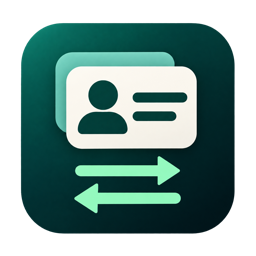

# StoreSwitch · Switch App Store Accounts

[简体中文](README.md) · **English**

StoreSwitch is a macOS menu bar app that lets you save multiple Apple Accounts and helps you switch between them in the Mac App Store. It supports macOS 14 and later.

## Install

1. Download the `.dmg` file from the release assets. [GitHub Releases](https://github.com/PSSDeveloper/StoreSwitch/releases)
2. Double-click the DMG and drag `StoreSwitch.app` into the Applications folder.
3. Open StoreSwitch from Applications in Finder. Click the two-arrow icon in the menu bar to use the app.

### If Gatekeeper blocks the first launch

StoreSwitch releases ship without Apple Developer ID signing or notarization. On the first launch, macOS may say it can’t verify the developer or check the app for malware. If you’ve confirmed that the DMG came from this project’s GitHub Releases, you can add an exception for your installed copy of StoreSwitch.

1. Try opening StoreSwitch from Applications, then dismiss the alert.
2. Go to **System Settings → Privacy & Security**. Scroll down to **Security**, find the message about StoreSwitch, and click **Open Anyway**. If you see **Open** there, click it first, then choose **Open Anyway** in the confirmation dialog.
3. Follow the macOS prompts to confirm and authenticate if asked.

If you can’t find the message, try opening StoreSwitch from Applications again and return to System Settings. If macOS reports that the app is damaged or detects malware, stop and verify the download source. [Apple Support — Safely open apps on your Mac](https://support.apple.com/en-us/102445)

## Grant Accessibility access

StoreSwitch uses Accessibility access to check whether you’re signed in to the App Store, help you sign out, and fill in the sign-in form.

1. Open the StoreSwitch menu, choose **Grant Accessibility Access…**, then click **Open System Settings**. StoreSwitch also shows the permission guide when needed the first time you switch accounts or check your sign-in status.
2. Under **System Settings → Privacy & Security**, open **Device Control and Data Access** on macOS 27 or **Accessibility** on earlier versions, then turn on access for StoreSwitch. If it’s missing from the list, click **+** and add `StoreSwitch.app` from Applications.
3. Return to the StoreSwitch permission guide. It checks for access automatically. You can also click **Check Again**.

If the switch is on and StoreSwitch still can’t detect access, click **Show in Finder** in the guide to locate the running copy. In System Settings, remove the old StoreSwitch entry, add the copy Finder selected, and turn on access. You can turn off access there at any time. [Apple Support — Allow accessibility apps to access your Mac](https://support.apple.com/guide/mac-help/mh43185/mac)

## Add and switch accounts

1. From the menu bar, choose **Add Account…** or **Manage Accounts…**. Enter your Apple Account email address and choose a region if needed.
2. To use automatic sign-in, click **Set Password** and enter the password in the account row. You can leave it blank and sign in manually when switching. Click **Save** once. StoreSwitch keeps saved passwords in the local macOS Keychain.
3. Select the account you want to switch to from the menu. If you’re already signed in to the App Store, confirm the target email address and click **Sign Out and Continue**.
4. Finish signing in through the App Store. StoreSwitch tries to fill in the email address and, if you saved a password, submit the sign-in form. Complete any verification codes or Touch ID prompts in Apple’s interface. If the form doesn’t fill in automatically, you can continue manually.

Choose **Check Sign-In Status** from the menu to see whether you’re signed in. To confirm the active account or store region, check in the App Store.

StoreSwitch is available under the [MIT License](LICENSE).
