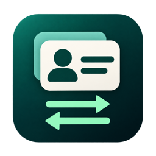

# StoreSwitch · App Store 账号切换

**简体中文** · [English](README.en.md)

StoreSwitch 是一款 macOS 菜单栏应用，可保存多个 Apple 账户，并协助你在 Mac 的 App Store 中切换账号。支持 macOS 14 及以上版本。

## 安装

1. 从 [GitHub Releases](https://github.com/PSSDeveloper/StoreSwitch/releases) 下载发布版本附件中的 `.dmg` 文件。
2. 双击打开 DMG，将 `StoreSwitch.app` 拖到「应用程序」文件夹。
3. 在访达的「应用程序」中打开 StoreSwitch。打开后，点击屏幕顶部菜单栏里的双向箭头图标即可使用。

### 首次打开被 Gatekeeper 拦截

当前发布包未使用 Apple Developer ID 签名，也未经过 Apple 公证。首次打开时，macOS 可能提示无法验证开发者，或无法检查应用是否包含恶意软件。确认 DMG 来自本项目的 GitHub Releases 后，可以为当前安装的 StoreSwitch 添加例外。

1. 先在「应用程序」中尝试打开 StoreSwitch，看到提示后关闭弹窗。
2. 打开 **系统设置 → 隐私与安全（或隐私与安全性）**，向下找到「安全性」中针对 StoreSwitch 的提示，点击「仍要打开」（Open Anyway）。如果该处显示「打开」，先点它，再在确认窗口中选择「仍要打开」。
3. 按系统提示确认。如果需要验证身份，请在 macOS 的系统弹窗中完成。

如果找不到对应提示，回到「应用程序」再次尝试打开 StoreSwitch，然后立即返回设置查看。如果 macOS 明确报告文件已损坏或检测到恶意软件，请停止打开，并核对下载来源。

[Apple 支持：在 Mac 上安全地打开 App](https://support.apple.com/zh-cn/102445)

## 开启辅助功能权限

StoreSwitch 需要这项权限来检查 App Store 的登录状态，以及协助退出和填写登录表单。

1. 从菜单栏打开 StoreSwitch，选择「开启辅助功能权限…」，再点「打开系统设置」。首次切换账号或检查登录状态时，应用也会在需要时打开授权引导。
2. 在 **系统设置 → 隐私与安全（或隐私与安全性）** 下，打开「设备控制和数据访问」（macOS 27）或「辅助功能」（较早版本），开启 StoreSwitch 的开关。如果列表里没有 StoreSwitch，点「＋」添加「应用程序」中的 `StoreSwitch.app`。
3. 回到 StoreSwitch 的授权引导。应用会自动检查权限，也可以点「重新检查」。

如果开关已打开但仍未检测到授权，在引导里点「在访达中显示」，确认当前运行的是哪份 App。回到系统设置移除旧的 StoreSwitch 授权条目，再添加这份 App 并打开开关。你也可以随时在同一处关闭权限。

[Apple 支持：允许辅助功能 App 访问你的 Mac](https://support.apple.com/zh-cn/guide/mac-help/mh43185/mac)

## 添加和切换账号

1. 从菜单栏选择「添加账号…」或「管理账号…」，填写 Apple 账户邮箱，按需选择地区。
2. 如需自动登录，点该账号的「设置密码」，在行内输入密码。也可以留空，切换时手动登录。点一次「保存」即可。保存的密码只存于本机钥匙串。
3. 从菜单选择目标账号。如果 App Store 已登录，请核对目标邮箱，再确认「退出并继续」。
4. 在 App Store 中完成登录。StoreSwitch 会尝试填写邮箱；如果你设置了自动登录密码，它也会尝试提交登录。验证码、Touch ID 等验证由你在 Apple 界面完成。若表单未能自动填写，可以手动继续。

可从菜单选择「检查登录状态」。需要确认当前账号或商店地区时，请在 App Store 中查看。

本项目采用 [MIT 许可证](LICENSE)。
